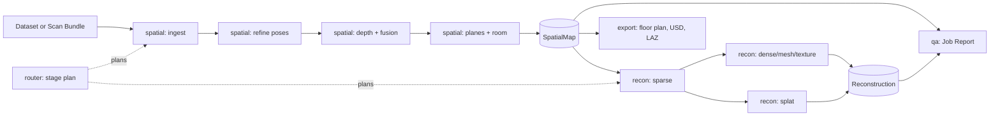

# Architecture

> This file describes how the modules fit together. It does not copy formats: every on-disk
> format, field and convention is owned by [INTERFACES.md](INTERFACES.md) and
> [SCAN_BUNDLE.md](SCAN_BUNDLE.md). Phase status is owned by [PROGRESS.md](../PROGRESS.md).

## Overview
Part 3 (`spatial/`) turns a capture into a **SpatialMap** folder: refined metric,
gravity-aligned poses, depth, a fused cloud, planes and the room shell. Part 4 (`recon/`)
reads only that folder and writes a **Reconstruction** folder: sparse model, OpenMVS dense
cloud, mesh, textured mesh and GLB, and a Gaussian splat as a separate output (HANDOFF.md §2
rules 1-2).

The P11 glue modules (`router/`, `qa/`, `export/`) sit around the two parts. `qa/` and
`export/` read only the on-disk formats through `formats/`; `router/` is pure planning
logic. `eval/` holds metrics and ground-truth access and is used only by tests and
benchmarks.

Every stage writes its intermediates and a `meta.json` into a run directory under `runs/`
(HANDOFF.md §2 rule 6, §4.4; [INTERFACES.md §5](INTERFACES.md)).

## Diagram


## Folder structure of the codebase
```
formats/      pydantic models + validators for every on-disk format (shared by all)
spatial/      Part 3: io/ (adapters, ingest, keyframes, scanbundle), sfm/, depth/, fusion/,
              room/, spatial_map.py, pipeline.py, cli.py
recon/        Part 4: sparse.py, openmvs.py, dense.py, splat/, render.py, evaluate.py,
              package.py, cli.py
router/       requested outputs + capture tier -> stage plan (pure logic)
qa/           QA gates -> Job Report with rescan regions; thresholds in qa/thresholds.py
export/       SVG/DXF floor plan, USD room shell, LAZ cloud, measurements
eval/         metrics, GT loaders, synthetic room, reference bundle writer
              (tests/benchmarks only)
spec/         JSON Schemas exported from formats/ (scripts/export_schemas.py)
benchmarks/   Phase 3 benchmark suite and figures
scripts/      phase-report renderer, schema export, heavy-compute runner, charter scripts
docker/       openmvs, eth3d-eval, cuda images
data/         dataset fetch scripts (datasets themselves are gitignored)
runs/         run outputs (gitignored)
tests/        pytest suite, resource markers defined in pyproject.toml
```

## Main modules
| Module | Responsibility | Depends on | CLI |
|---|---|---|---|
| `formats/` | on-disk models, validators | none of the project packages | none |
| `spatial/` | Part 3: capture -> SpatialMap | `formats/` | `python -m spatial.cli {validate-bundle,ingest,refine,phase3,room,run}` |
| `recon/` | Part 4: SpatialMap -> Reconstruction | `formats/` | `python -m recon.cli run` |
| `router/` | stage plan, refusals, budget flag | no project package (pure logic) | `python -m router.cli plan` |
| `qa/` | gates and Job Report | `formats/` | `python -m qa.cli report` |
| `export/` | exports from a SpatialMap | `formats/` | `python -m export.cli all` |
| `eval/` | metrics, GT, fixtures | anything; never imported by pipeline code | none |

Exact flags, outputs and fields: [INTERFACES.md](INTERFACES.md) (§1-7 per phase, §8 for
router/qa/export), [SCAN_BUNDLE.md](SCAN_BUNDLE.md) for the bundle.

## Module boundary test
[INTERFACES.md §9](INTERFACES.md) defines the boundaries; `tests/test_module_boundaries.py`
(marker `light`) enforces them by parsing imports. The `FORBIDDEN` table in that test is the
authority; in short: `spatial` and `recon` never import each other, no pipeline package imports
`eval`, and `router` also does not import `qa` or `export`. A change to the boundaries changes
INTERFACES.md §9 and the test in the same commit.

## Data model (key entities)
| Entity | Owner of the definition |
|---|---|
| Scan Bundle | [SCAN_BUNDLE.md](SCAN_BUNDLE.md), `formats/scanbundle.py` |
| Workspace (`priors.json`, `workspace_meta.json`) | [INTERFACES.md §1-3](INTERFACES.md) |
| Planes / room (`planes.json`, `room.json`) | [INTERFACES.md §4](INTERFACES.md) |
| Stage `meta.json` | [INTERFACES.md §5](INTERFACES.md) |
| SpatialMap | [INTERFACES.md §6](INTERFACES.md), `formats/spatial_map.py` |
| Reconstruction | [INTERFACES.md §7](INTERFACES.md), `formats/reconstruction.py` |
| Job Report, router plan, exports | [INTERFACES.md §8](INTERFACES.md) |
| Coordinate conventions | [INTERFACES.md §0](INTERFACES.md) |

## Key flows
### Part 3 end to end
1. Ingest a dataset or Scan Bundle into a workspace (undistorted images, priors,
   optional depth).
2. Refine poses with SfM + priors; output is metric and gravity-aligned.
3. Choose depth source, align, filter, fuse into a cloud and TSDF mesh.
4. Extract planes and the room shell.
5. Assemble and hash the SpatialMap. `python -m spatial.cli run` chains 1-5.

### Part 4 end to end
1. Load the SpatialMap through `formats/` only.
2. Sparse hand-over to OpenMVS and the splat initialiser.
3. OpenMVS dense -> mesh -> texture -> GLB (CPU, docker); splat training (CUDA only,
   recorded as `skipped` without it).
4. Package with a hashed manifest. `python -m recon.cli run`.

### Downstream
`qa.cli report` grades a SpatialMap (and optionally a Reconstruction); `export.cli all`
writes exports; `router.cli plan` names the stage commands for requested outputs.
